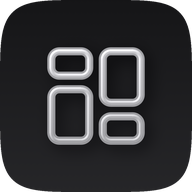
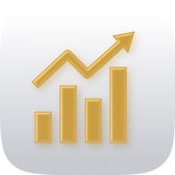
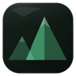
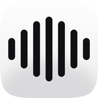

### Hi, I'm Jonas

I build native apps for iPhone, iPad and Mac — SwiftUI throughout, no accounts, no
tracking, and your data stays on your device.

---

**[Dashlytics](https://dashlytics-app.com)** ([App Store](https://apps.apple.com/app/id6811113159)) — know when your sites need you. Deploys,
domain expiry, uptime, analytics and search data from 28 hosting platforms, registrars
and site services in one workspace for iPhone, iPad and Mac. Reads straight from each
provider's API; credentials stay in the Keychain, never on a server of mine.
 

**[Wealth Level](https://wealth-level.app)** ([App Store](https://apps.apple.com/app/id6811080068)) — net worth as a monthly ritual. Two minutes
a month, entered by hand: your curve, your level, and where you stand among all adults
in Germany. No bank login, no backend, free. iPhone, iPad and Mac, with widgets.
 

**[Peak Life](https://peak-life.app)** ([App Store](https://apps.apple.com/app/id6785643101)) — habits, goals, your life in weeks, and a map of
every country you've been to. A calm, native iOS app; data stays on the device and
syncs only through iCloud.
 

**[Notable](https://github.com/jonas-gehring/notable)** — dictation and meeting
transcription for macOS. Hold a key, speak, let go; the text lands in whatever field you
were typing in. Audio never leaves the device — recognition, segmentation and diarization
all run on the Neural Engine. Open source.
 

---

Swift · SwiftUI · SwiftData · CoreML · WidgetKit · CloudKit
